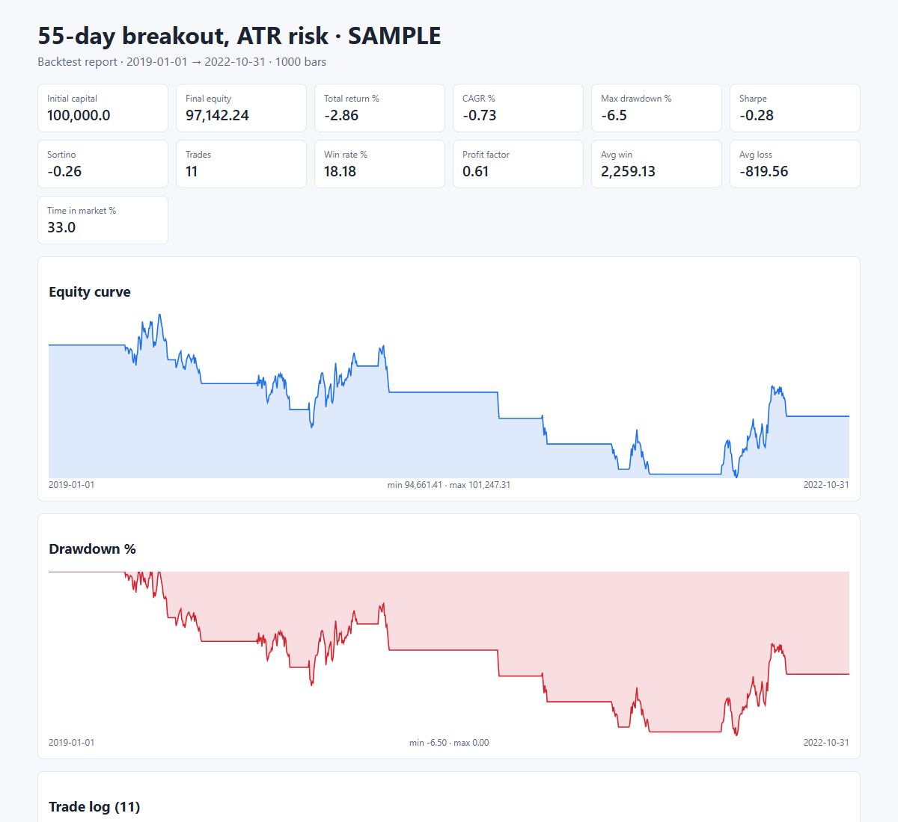

# Strategy Backtester (stocks & ETFs)

A config-driven backtesting engine. You describe the trading rules in a TOML file, point it at OHLCV history, and get an equity curve, drawdown, Sharpe/Sortino, win rate, profit factor and a full trade log as CSV plus a self-contained HTML report.

Built by **Key M Tech** as a portfolio demo. Pure Python with pandas and numpy only; runs offline on Windows, macOS and Linux.



## What it does

- **Rules in one config file.** Entries, exits, stops, targets and position sizing are all set in TOML, so changing them means editing the file, not the code.
- **No look-ahead.** Signals are read on a bar's close and filled at the next bar's open. Stops and targets are checked against later bars' high and low. If a bar gaps through a stop, the fill is the open, not the stop price. If one bar touches both the stop and the target, the stop is assumed to have filled first.
- **Realistic costs.** Percentage commission, a fixed fee per order, and slippage applied against you on every fill. It never buys more than the cash on hand.
- **Position sizing.** Three methods: `fixed_fraction` of equity, `fixed_qty`, or `risk_pct`, which risks N% of equity based on the distance to the stop.
- **Exits.** Exit-rule signal, % stop, ATR stop, % target, R-multiple target, and a maximum number of bars in a trade.
- **Indicators.** SMA, EMA, Wilder RSI, Wilder ATR, highest high, lowest low. Adding one takes about five lines in `indicators.py`.
- **Rule operators.** `>`, `>=`, `<`, `<=`, `crosses_above`, `crosses_below`, combined with `all` (AND) or `any` (OR).
- **Outputs.** `report.html`, `trades.csv`, `equity.csv` (with a drawdown column) and `metrics.json`.
- **Multiple symbols.** Pass several CSVs and each one gets its own report folder.

## Quick start

```bash
pip install -r requirements.txt
python -m backtester --config configs/sma_crossover.toml --data data/SAMPLE.csv
python -m backtester --config configs/breakout_atr.toml  --data data/SAMPLE.csv --out reports/breakout_atr
python -m pytest -q
```

To use your own data, give it a CSV with `date, open, high, low, close[, volume]` columns. Column names can be in any case.

## Strategy file

```toml
name = "55-day breakout, ATR risk"

[account]
initial_capital = 100000
commission_pct = 0.03     # % per side
commission_fixed = 20     # per order
slippage_pct = 0.05

[position_sizing]
method = "risk_pct"       # fixed_fraction | fixed_qty | risk_pct
risk_pct = 1.0

[indicators]
hh_55  = { type = "highest", period = 55 }
ll_20  = { type = "lowest",  period = 20 }
rsi_14 = { type = "rsi",     period = 14 }
atr_14 = { type = "atr",     period = 14 }

[entry]
mode = "all"
conditions = [
  { left = "close",  op = ">", right = "hh_55" },
  { left = "rsi_14", op = "<", right = 80 },
]

[exit]
mode = "any"
conditions = [ { left = "close", op = "<", right = "ll_20" } ]

[exits]
atr_column = "atr_14"
stop_loss_atr = 2.0
take_profit_r = 3.0
max_bars_in_trade = 60
```

## Verification

`tests/test_engine.py` contains 10 cases that were checked by hand on paper. They cover:

- next-bar-open fills
- gap-through-stop fills
- take-profit with slippage and fees
- end-of-data close
- risk-based sizing
- the cash cap
- cross-signal logic
- metric and indicator reference values
- deterministic synthetic data

## Project layout

```
backtester/
  engine.py      bar-by-bar simulation, fills, stops, sizing
  rules.py       config conditions -> boolean signals
  indicators.py  SMA / EMA / RSI / ATR / highest / lowest
  metrics.py     return, CAGR, drawdown, Sharpe, Sortino, win rate, profit factor
  report.py      CSV + JSON + HTML report (inline SVG charts, no external assets)
  data.py        CSV loader + synthetic GBM data generator
configs/         example strategies
data/SAMPLE.csv  synthetic demo prices (not real market data)
reports/         sample output
tests/
```

## Limits

- Long-only, one position per symbol at a time. Shorting and pyramiding are not built in yet.
- Daily or intraday bars both work, but fills are simulated from OHLC, not from ticks.
- `data/SAMPLE.csv` is synthetic, so the sample results show what the engine does, not how a strategy performs. Use your own licensed market data for real decisions.

## Hire

Key M Tech: RPA, AI agents and automation. See the [portfolio](https://trabl3moon.github.io/keymtech-portfolio/) or the [Freelancer profile](https://www.freelancer.com/u/rahulid6).
